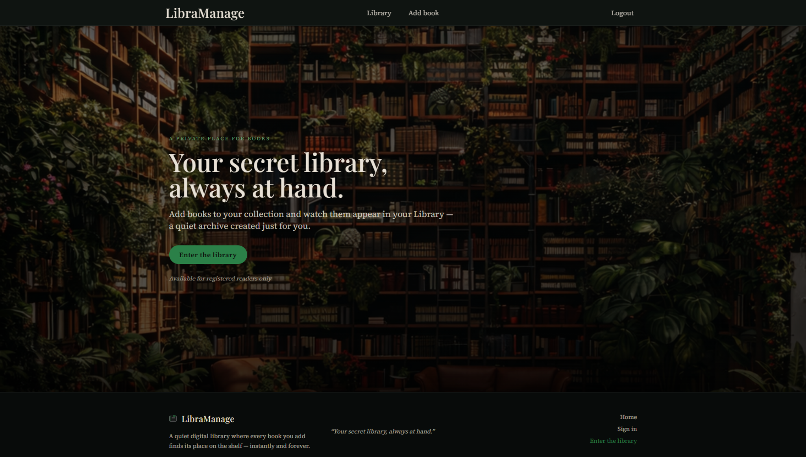
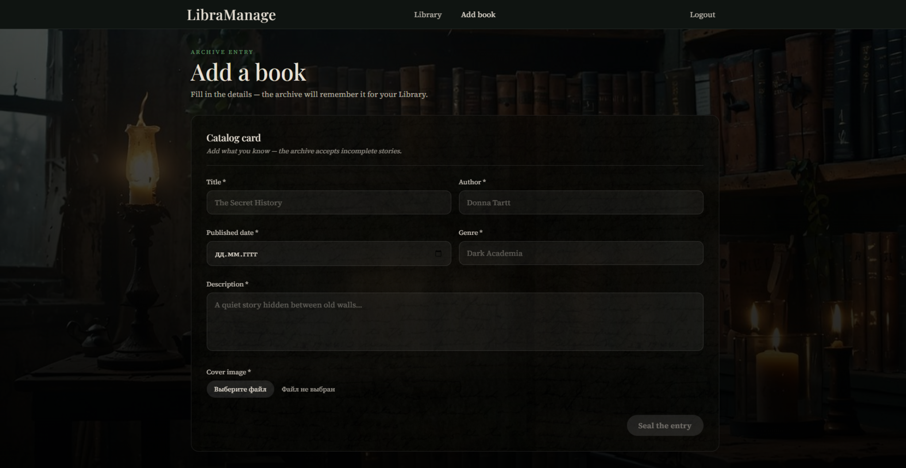
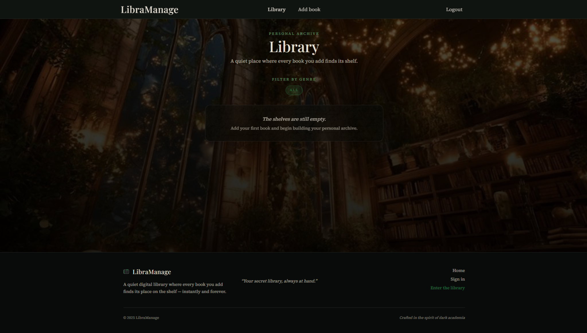
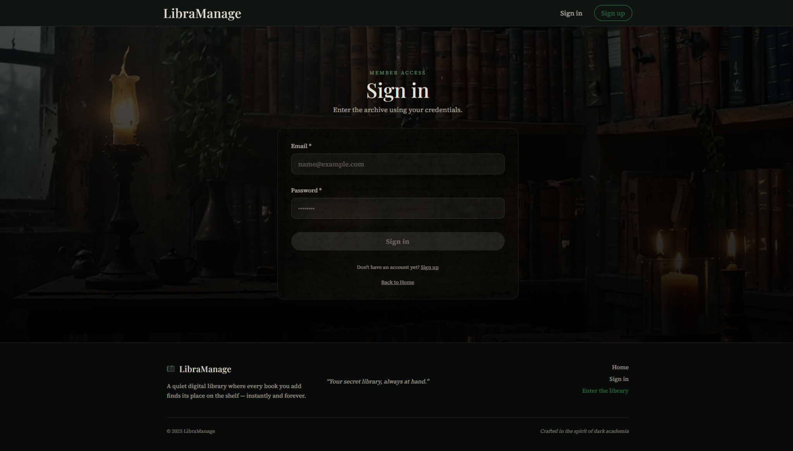
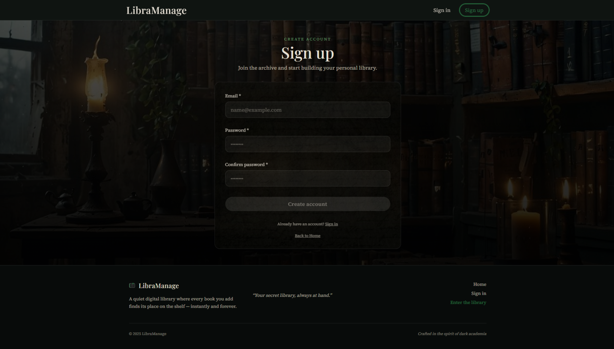

# 📚 LibraManage — Books Manager 

> *A quiet digital library where every book you add finds its place on the shelf — instantly and forever.*

**LibraManage** is a small pet-project built with **React + Vite + Tailwind CSS** in a **Dark Academia** aesthetic.  
It includes mock authentication (stored in Redux and persisted in localStorage), protected routes, a personal library with genre filtering, a book creation form, and a modal for viewing and deleting books.

---

## 🖼️ Screenshots

<p align="center">
  
</p>

<p align="center">
  
</p>

<p align="center">
  
</p>

<p align="center">
  
</p>

<p align="center">
  
</p>

---

## ✨ Features

### 🔐 Authentication (mock + persisted)
- **Sign In / Sign Up** pages with validation (touched + blur)
- Authentication state stored in **Redux Toolkit (`authSlice`)**
- User session persists via **localStorage** (refresh doesn’t log you out)
- Header navigation updates automatically based on auth state
- **Protected routes**:
  - non-authorized users **don’t see** `Library` and `Add book` in the header
  - direct access to `/library` and `/addBook` is blocked via `<ProtectedRoute />`
  - auth state is read directly from Redux


### 🗃️ Books library (Redux + persisted)
- Books stored in **Redux Toolkit (`booksSlice`)**
- Library persists via **localStorage** (books survive page reload)
- Books grid (cards)
- Book details in a modal
- Delete a book from the modal
- **Genre filter** (derived dynamically from current books)
- Empty state supports:
  - “library is empty”
  - “no books for this filter”


### 🕯️ Dark Academia UI
- “Archive glass” cards with parchment texture (`.card-archive`)
- Atmospheric background images + overlay gradients
- Consistent typography (serif titles + serif body)

---

## 🧠 State Management (Redux Toolkit)

This project uses **Redux Toolkit** to manage global state across pages (not only between components).

### Redux slices
- **`booksSlice`**
  - Stores all books in `state.books.items`
  - Actions: `addBook`, `removeBook`
  - Selector: `selectBooks`

- **`authSlice`**
  - Stores current user in `state.auth.user`
  - Actions: `signIn`, `signUp`, `signOut`
  - Selectors: `selectUser`, `selectIsAuth`

### Persistence (localStorage)
Redux state is persisted to localStorage:

- Books key: `books-manager-books`
- User key: `books-manager-user`

**Implementation approach:**
- Initial Redux state is loaded from localStorage (`loadBooks()`, `loadUser()`)
- `store.subscribe()` automatically saves updated state after each dispatch
- Components never interact with localStorage directly

### Protected Routes
`<ProtectedRoute />` checks authorization via Redux selector (`selectIsAuth`) and blocks access to protected pages.

---

## 🎨 Design tokens (Tailwind)

These are the main theme tokens used across the UI.

### Fonts
- `font-heading`: **Playfair Display** (headings)
- `font-body`: **Source Serif 4** (body)

### Colors
| Token | Hex / value | Usage |
|------|-------------|-------|
| `bm-bg` | `#0B0F0D` | app background |
| `bm-surface` | `#121814` | panels / cards |
| `bm-surface-2` | `#182019` | secondary surfaces |
| `bm-border` | `rgba(255,255,255,0.08)` | subtle borders |
| `bm-text` | `#E8E1D6` | primary text (parchment) |
| `bm-muted` | `#B8B0A4` | muted text |
| `bm-accent` | `#2B8048` | accent / active states |
| `bm-accent-2` | `#76B27E` | soft accent / hover |

---

## 🧱 Tech Stack
- React
- Vite
- Tailwind CSS
- React Router DOM
- Redux Toolkit
- React Redux
- localStorage (state persistence)

---

## 🗂️ Project Structure

```bash
src/
  components/
    UI/
      Field.jsx
    BookCard.jsx
    BookForm.jsx
    BookModal.jsx
    BooksList.jsx
    EmptyState.jsx
    Footer.jsx
    Header.jsx
    ProtectedRoute.jsx
  pages/
    AddBook.jsx
    Home.jsx
    Library.jsx
    SignIn.jsx
    SignUp.jsx
  redux/
    store.js
    booksSlice.js
    authSlice.js
  shared/
    storage/
      booksStorage.js
      authStorage.js
  App.jsx
  main.jsx
  index.css
public/
  parchment.webp
  addBook_background.jpg
  library_background.jpg
  signup_background.jpg
```

---

## 🧭 Routes

| Route | Page | Access |
|------|------|--------|
| `/` | Home | Public |
| `/signIn` | Sign In | Public |
| `/signUp` | Sign Up | Public |
| `/library` | Library | Protected |
| `/addBook` | Add Book | Protected |

---

## 🚀 Getting Started

```bash
npm install
npm run dev
```

---

## 📜 License

Created for learning purposes.
